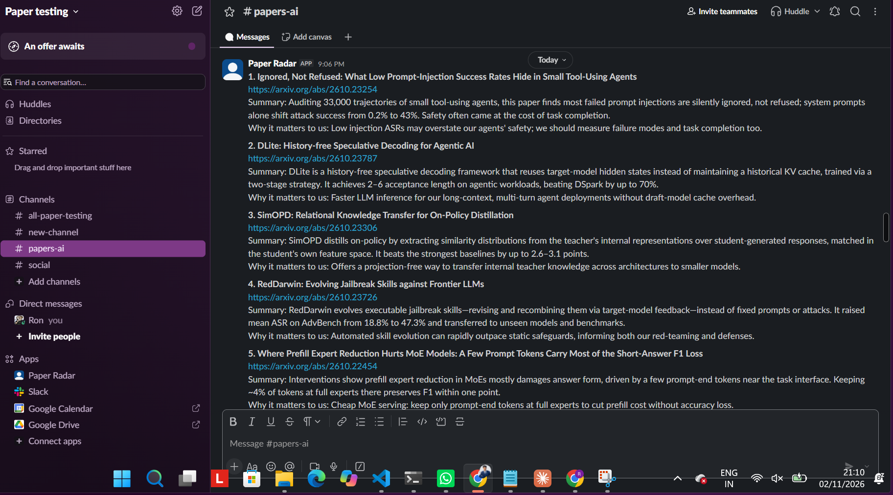
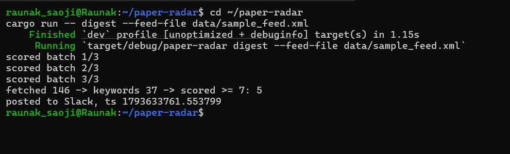
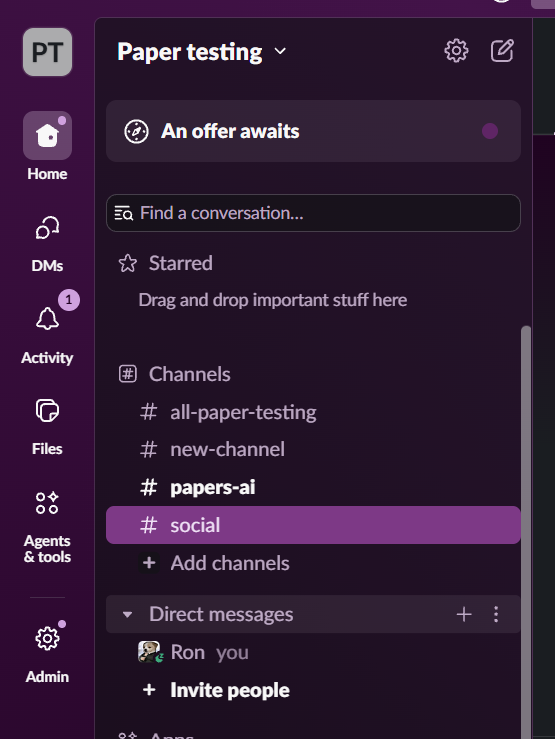
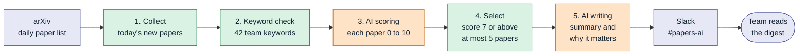
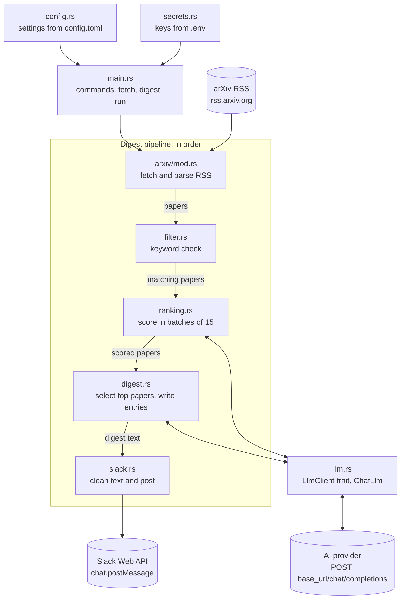
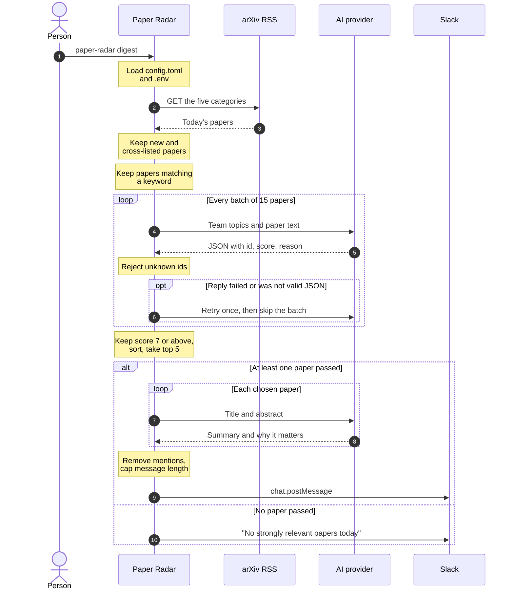

# Paper Radar

Paper Radar is a Slack bot that reads the day's new AI research papers from arXiv, picks the few that matter to our team, and posts a short summary of each one.

Hundreds of new papers appear on arXiv every weekday. Nobody on a team of about 16 people can read them all, so useful work gets missed. Paper Radar does the first pass, and people spend their time only on papers likely to help them.



*A real digest posted by the bot to `#papers-ai` in our test workspace.*

**Contents:** [What it does](#what-it-does) · [How it works](#how-it-works-in-plain-language) · [How AI is used](#how-ai-is-used) · [Benefits](#why-this-helps-us) · [High-level diagram](#high-level-diagram) · [Low-level diagram](#low-level-diagram) · [How we built it with Loop](#how-we-built-it-with-loop) · [Design decisions](#what-we-thought-and-why) · [Options we rejected](#options-we-considered-and-did-not-use) · [Status](#current-status) · [Run it](#run-it-yourself)

---

## What it does

Each digest contains up to 5 papers. Each paper has:

- its title and a link
- a summary of at most 2 short sentences
- a "Why it matters to us" line

The bot never fills the list just to reach 5. If only 2 papers are good enough, it posts 2. If none are, it posts "No strongly relevant papers today", or stays silent if the `post_when_empty` setting is off.

## How it works, in plain language

The bot works through five steps. The first two use no AI, so they are free and instant.

1. **Collect.** It downloads the list of papers arXiv announced that day in five subject areas: language models, machine learning, general AI, distributed computing and security.
2. **Keyword check.** It keeps a paper only if its title or abstract contains at least one of our 42 team keywords, such as `SGLang`, `jailbreak` or `KV cache`. The team can edit this list in `config.toml`.
3. **AI scoring.** The AI reads each remaining title and abstract, compares it with our team's topics, and gives it a score from 0 to 10.
4. **Selection.** Papers scoring below 7 are dropped. The highest scorers are kept, up to 5.
5. **Writing and posting.** The AI writes the summary and the "why it matters" line for each chosen paper, and the bot posts the digest to Slack.

Here is a real run on one day of the language-models category:

| Step | Papers left |
|---|---|
| Papers collected | 146 |
| After the keyword check | 37 |
| After AI scoring (7 or above, top 5) | 5 |



*The same run in the terminal, ending with the Slack post.*



*The bot posts to a dedicated `#papers-ai` channel, in a separate test workspace.*

## How AI is used

AI does exactly two jobs:

| Job | What the AI receives | What it returns |
|---|---|---|
| **Scoring** | Our topics, plus 15 paper titles and abstracts at a time | A score from 0 to 10 and a one-line reason for each paper, as JSON |
| **Summarising** | One chosen paper's title and abstract | A short summary and a "Why it matters to us" line |

Everything else is ordinary code: downloading papers, the keyword check, the score cut-off, the 5-paper limit, and posting to Slack. The AI cannot decide where the bot posts, which websites it visits, or what files it touches. It has no tools, so the only thing it can do is return text.

The run above needed 8 AI requests: 3 for scoring and 5 for summaries. Without the keyword check, scoring alone would have taken 10 requests instead of 3.

The bot does not depend on one AI provider. It works with any service that offers an OpenAI-compatible chat API, and changing provider means changing settings and one key, not code. So far it has only been run on Soket's GLM-5.3 model. The other providers are supported by design and still need to be tried.

## Why this helps us

- **Saves reading time.** The team sees at most 5 papers a day out of hundreds.
- **Relevant to our work.** Papers are judged against what we actually do, such as inference, Indic languages, RL and model attacks, instead of what is popular.
- **Explains itself.** The "why it matters" line says why a paper is worth opening before anyone reads it.
- **Fits how we work.** The team already uses Slack, so nobody needs another site or login.
- **Quiet by design.** A weak day produces a short post or nothing, so the channel stays worth reading.
- **Easy to change.** Topics, keywords, score cut-off and AI provider are all settings.

---

## High-level diagram

This shows the whole system. Green steps use no AI. Orange steps are the only ones that talk to an AI model. Topics, keywords, limits and the model choice are read from `config.toml`.



## Low-level diagram

This is for engineers. The first diagram shows the Rust modules and how data moves between them.



The second diagram shows one `digest` run in order.



### Modules

| File | Responsibility |
|---|---|
| `src/main.rs` | Command line: `fetch`, `digest`, `run`, and the pipeline order |
| `src/config.rs` | Loads `config.toml` and rejects typos and bad values |
| `src/secrets.rs` | Loads keys and tokens from the environment or `.env`; printing them shows `[REDACTED]` |
| `src/arxiv/mod.rs` | Downloads and parses the RSS feed with an allowlist, timeouts, a size cap and a rate limit |
| `src/filter.rs` | Keyword check that matches whole terms, so `Rust` does not match `trust` |
| `src/ranking.rs` | Builds scoring prompts, checks the JSON reply, retries once |
| `src/digest.rs` | Applies the cut-off and the 5-paper limit, and asks for summaries |
| `src/llm.rs` | HTTP client for any OpenAI-compatible provider, plus a fake client for tests |
| `src/slack.rs` | Removes mentions such as `@channel`, caps length, posts the message |

---

## How we built it with Loop

Loop is Soket's coding agent. This project was built with Loop for an internal hackathon: Loop, running GLM-5.3, wrote the code in this repository. Claude Code helped plan the work, wrote the prompts given to Loop, and reviewed each result.

**Loop built the bot, but the finished bot does not need Loop to run.** The first version did use Loop as a library inside the bot. We removed that once it was clear the bot only needs a chat request to a model.

The process was:

1. **Write the rules first.** `AGENTS.md` holds the spec and security rules. Loop reads this file before every task.
2. **Give one small task at a time.** Each prompt covered one function or one small change.
3. **Decide the design before asking.** Prompts stated the exact design and ended with "Do not plan; write the code now."
4. **Check every step.** Each task had to pass `cargo fmt`, `cargo clippy` and `cargo test`, and each commit was reviewed before the next prompt.

Our first prompts were too large. GLM-5.3 thinks before it answers, and that thinking counts towards Loop's output limit of 16,384 tokens. On a large task the model could use the whole limit thinking, write nothing, and Loop would return to `ready` with no error. Small prompts with the design already decided fixed this. We recorded this and other issues as feedback for the Loop team.

## What we thought, and why

| Decision | Why |
|---|---|
| **Post to Slack** | The team is already there, so nobody has to remember to check something new. |
| **Filter with keywords before using AI** | It is free and instant, and it cut the AI's reading list from 146 papers to 37 in our test run. |
| **Use AI for judgement, not just keywords** | A keyword shows a paper mentions a topic. It cannot show whether the paper is useful to our team. |
| **Use a score cut-off, not a fixed number of papers** | Always posting 5 would mean posting weak papers on quiet days, and people would stop reading. |
| **Keep the 5-paper limit** | A short list gets read. A long one gets skipped. |
| **Treat paper text as untrusted** | Anyone can publish a paper. A paper could contain text written to instruct an AI, so paper text is clearly marked as data and the model has no tools. |
| **Keep the AI behind one interface** | Nothing outside `llm.rs` knows which provider is in use, and tests run with a fake AI, so they never need the network. |
| **Support any provider through one request format** | The bot is not tied to one key or vendor. A team can use its own gateway or whichever model suits it. |
| **Use settings, not code, for team choices** | Keywords, topics and limits change often, and changing them should not need an engineer. |

## Options we considered and did not use

| Option | Why we did not use it | What we did |
|---|---|---|
| **Twitter/X as a source** | The API is paid, scraping breaks its terms, most posts are noise, and anyone can write the text that reaches our model. | Used arXiv, which is free and structured. |
| **arXiv search API for daily papers** | It does not include papers that are announced but not yet indexed, and our date-window query returned 0 papers. | Used arXiv's RSS feed, which lists each day's announcements. The search code is kept for looking up single papers. |
| **Sending every paper to the AI** | About 500 papers each weekday is slow and costly, and most are not relevant. | Added the free keyword check first. |
| **A website instead of a Slack bot** | People would have to remember to visit it. | Posted to Slack. |
| **Loop harness inside the running bot** | It worked, and it was the first version. It added a large dependency and tied the bot to one provider, while the bot only needs one chat request. | Replaced it with a small HTTP client. This removed about 700 lines from the code and lock file. |
| **Only one provider's key** | The bot should not stop working if that key is unavailable or not meant for this use. | Made the provider a setting. |
| **Letting the AI browse or use tools** | A paper's text could try to trick the AI into acting. | Gave the AI no tools. Our code does all fetching and posting. |
| **Turning off the model's thinking** | Soket's API rejected the options we tried, with errors 400 and 502. | Raised the output limit to 32,768 tokens and kept each request small. |

## Security

- `.env` holds the keys and tokens. It is in `.gitignore` and is never committed.
- Keys are hidden if printed, and the AI key is removed from any error text.
- The bot never follows redirects on AI calls, so the key only reaches the configured host.
- The AI provider address must use HTTPS, except for a model running on the same machine.
- arXiv requests go only to approved arXiv hosts, with timeouts, a size limit and a rate limit.
- `@channel`, `@here` and user mentions are removed from AI text before posting.

## Current status

**Working today**

- Fetching the live arXiv feed for all five categories (407 papers on 2 November 2026)
- Keyword check, AI scoring and paper selection
- Summaries and posting to Slack
- Provider settings and `--dry-run`
- 54 automated tests, none of which call a real service

**Not built yet**

- **"Go deeper on #N" replies.** The digest already shows this hint, but the bot does not answer it yet.
- **Daily schedule.** The bot runs when someone starts it. `paper-radar run` is a placeholder.
- **Learning from the team.** Using papers shared in Slack and 👍/👎 reactions is planned, not built.
- **Duplicate tracking between days.** There is no database yet.
- **Testing on other AI providers.** Only Soket's GLM-5.3 has been used.
- **A full digest from the live feed.** The AI and Slack steps have been run on a saved feed from 19 October 2026. Fetching the live feed has been tested on its own.

## Run it yourself

You need Rust, a Slack app with a bot token, and an API key from any OpenAI-compatible provider.

```bash
git clone https://github.com/Ron2509/paper-radar.git
cd paper-radar
cp .env.example .env     # then add your own keys
cargo test
cargo run -- fetch --dry-run     # print today's papers
cargo run -- digest --dry-run    # print the digest, post nothing
cargo run -- digest              # post the digest to Slack
```

To change AI provider, edit `[model]` in `config.toml` and set `LLM_API_KEY` in `.env`:

| Provider | `base_url` | `max_tokens_field` |
|---|---|---|
| Soket | `https://api.soket.ai/v1` | `max_tokens` |
| LiteLLM gateway | your gateway URL plus `/v1` | `max_tokens` |
| OpenRouter | `https://openrouter.ai/api/v1` | `max_tokens` |
| OpenAI | `https://api.openai.com/v1` | `max_completion_tokens` |
| Claude | `https://api.anthropic.com/v1` | `max_tokens` |

Set `model` to that provider's model name. If a smaller model returns a 400 error, lower `max_tokens`.
